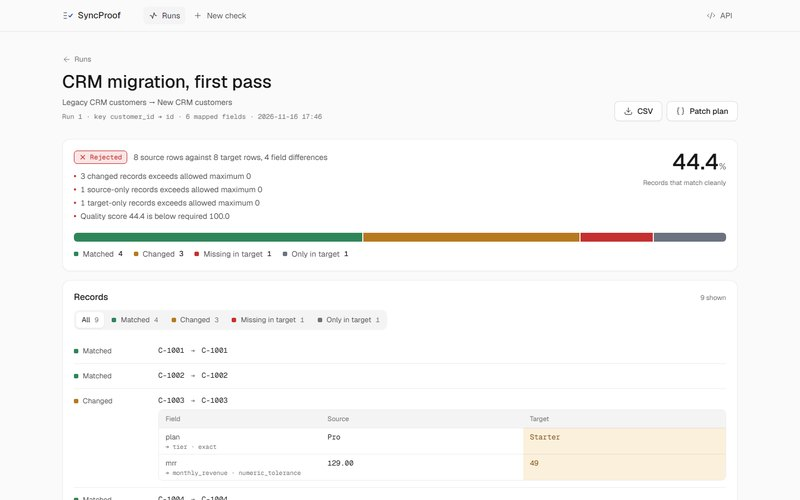
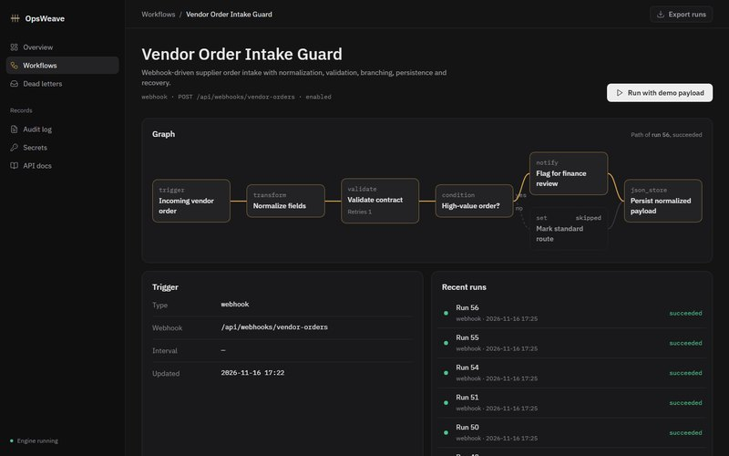
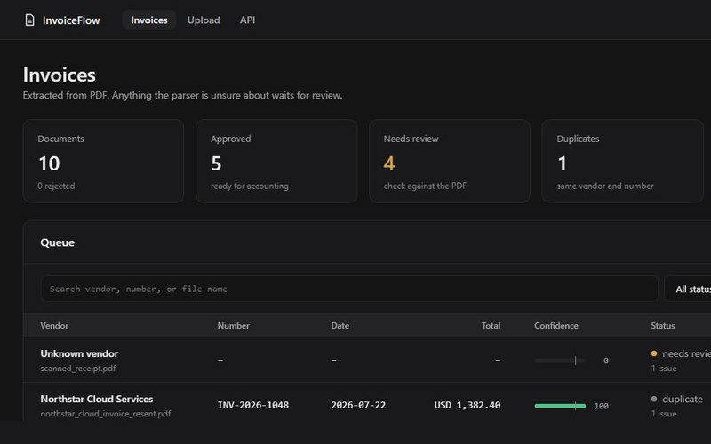
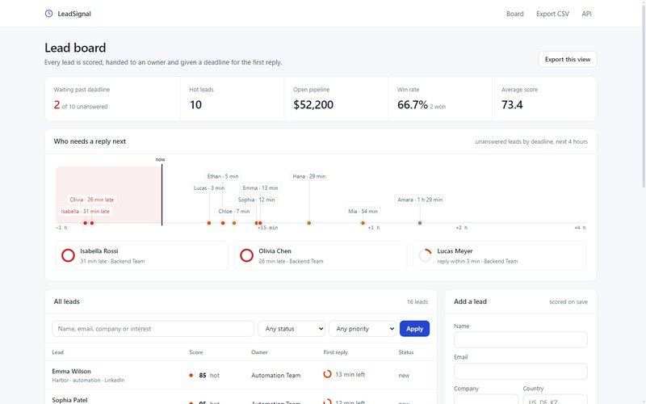
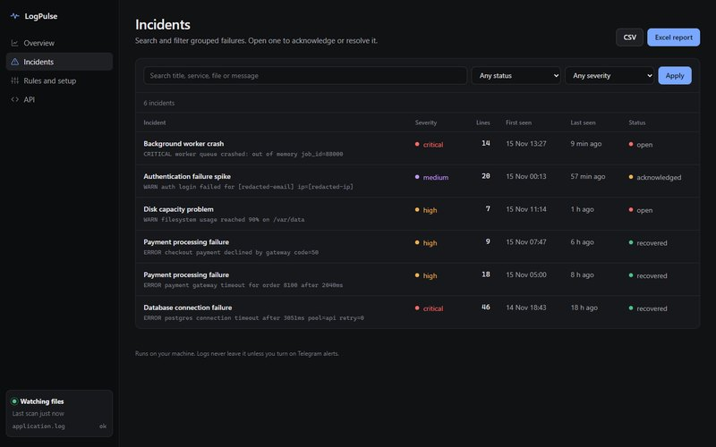
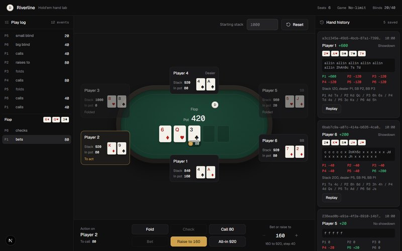

# Artyom Koncha

### Python backend and automation developer

I build webhooks, queues, integrations and data pipelines that recover from failures on their own, and show you exactly what happened when they can't.

[**Send me your task**](mailto:artyom129.x@gmail.com?subject=Project%20estimate&body=Hi%20Artyom%2C%0A%0A1.%20What%20the%20system%20does%3A%0A2.%20What%20goes%20wrong%20or%20what%20you%20need%3A%0A3.%20Deadline%3A%0A%0AThanks) · [Telegram](https://t.me/arttyism) · [LinkedIn](https://www.linkedin.com/in/artyom-python-automation/) · [Portfolio site](https://artyom129.github.io/)

I'm Artyom, based in Kazakhstan, and I take on project-based Python backend and automation work. Everything below is public: open a project, read the code, run it, check the tests.

## Which of these is your problem?

| You are dealing with | After the project | Open an example |
|---|---|---|
| Webhooks and integrations that fail without anyone noticing | Every event is stored, retried and replayable. A failure shows up on a dashboard instead of in a customer complaint | [Backplane](https://github.com/artyom129/backplane), [api-webhook-reliability-monitor](https://github.com/artyom129/api-webhook-reliability-monitor) |
| Background jobs that get stuck or run twice | Duplicate jobs are blocked, failed ones retry on their own, and the queue recovers after a crash | [QueueForge](https://github.com/artyom129/queueforge), [OpsWeave](https://github.com/artyom129/opsweave) |
| A SaaS that needs accounts, plans and limits | Login, roles, API keys, quotas, billing webhooks and an audit log are in place and tested | [TenantForge](https://github.com/artyom129/tenantforge), [CohortSwitch](https://github.com/artyom129/CohortSwitch) |
| A data migration or import that has to be right | You get a verdict, a report and a patch plan instead of a row count and a hope | [SyncProof](https://github.com/artyom129/syncproof), [DataDrop-Guardian](https://github.com/artyom129/DataDrop-Guardian) |
| Your team doing the same work by hand in spreadsheets, PDFs and a CRM | The data is cleaned, validated and routed automatically, and your team works from one dashboard | [Invoice dashboard](https://github.com/artyom129/invoice-document-automation-dashboard), [LeadSignal HQ](https://github.com/artyom129/leadsignal-hq), [RelayDesk](https://github.com/artyom129/RelayDesk-AI-Business-Automation-AI-Integration-Platform) |
| A booking or scheduling product | Conflicts are caught before they reach a customer, with a mobile client on top | [SlotBridge](https://github.com/artyom129/SlotBridge) |

## Work you can open

<table>
  <tr>
    <td width="33%" valign="top">
      
       <b><a href="https://github.com/artyom129/syncproof">SyncProof</a></b> 
      Verdict on a data migration, record by record. Found all 65 planted changes in a test. 
      FastAPI · SQLite · 27 tests
    </td>
    <td width="33%" valign="top">
      
       <b><a href="https://github.com/artyom129/opsweave">OpsWeave</a></b> 
      Workflow engine with step history, retries and failed runs you can replay once. 
      FastAPI · SQLite · 17 tests
    </td>
    <td width="33%" valign="top">
      
       <b><a href="https://github.com/artyom129/invoice-document-automation-dashboard">Invoice dashboard</a></b> 
      Reads invoice data from PDFs and queues the uncertain ones for review. 
      FastAPI · PDF · 110 tests
    </td>
  </tr>
  <tr>
    <td width="33%" valign="top">
      
       <b><a href="https://github.com/artyom129/leadsignal-hq">LeadSignal HQ</a></b> 
      Scores leads, routes them by keywords and tracks SLA deadlines. 
      Python · 63 tests
    </td>
    <td width="33%" valign="top">
      
       <b><a href="https://github.com/artyom129/logpulse-sentinel">LogPulse Sentinel</a></b> 
      Groups noisy log lines into incidents. On the demo logs, 68 events become 6. 
      Python · 34 tests
    </td>
    <td width="33%" valign="top">
      
       <b><a href="https://github.com/artyom129/fullstack-poker">Fullstack Poker</a></b> 
      Hold'em table with side pots and a showdown breakdown. 
      Next.js · FastAPI · 66 tests
    </td>
  </tr>
</table>

Test counts for the other main projects: TenantForge 128, SlotBridge 121, QueueForge 40, CohortSwitch 56, SyncProof 27. Each of them runs in CI on every push, and the latest runs are green.

## How a project goes

1. You describe the task. Three lines are enough: what the system does, what goes wrong, and the deadline.
2. I reply with a price and a timeline for that task.
3. If there is existing code, I read it first and write tests around the parts I will touch.
4. I build the work with tests and CI, and show you a version you can run.
5. You get the code in your repository, a README, and notes on how the system behaves when things fail. A Docker setup comes with it where the project needs one.

Security checks are part of the build: outbound request limits, signed callbacks, encrypted secrets, hashed API keys and CSV exports that are safe to open in Excel.

## Questions people ask

How much does it cost?

I price each task separately. Describe it and I reply with a price and a timeline.

Can you work with code that already exists?

Yes. I start by reading it and writing tests around the parts I will change, so a fix does not break something that worked.

What do I have at the end?

Working code in your repository, tests that run in CI, a README with run instructions, and notes on what the system does when a dependency fails.

Can I check your work before writing to you?

Yes, that is why every project above is public. Each has a README, screenshots and a test suite you can run yourself. The main READMEs are in English, Russian and Kazakh.

---

### Have a task like one of these?

Send three lines and I will reply with a price and a timeline.

[**Send me your task**](mailto:artyom129.x@gmail.com?subject=Project%20estimate&body=Hi%20Artyom%2C%0A%0A1.%20What%20the%20system%20does%3A%0A2.%20What%20goes%20wrong%20or%20what%20you%20need%3A%0A3.%20Deadline%3A%0A%0AThanks) · [Telegram @arttyism](https://t.me/arttyism)

